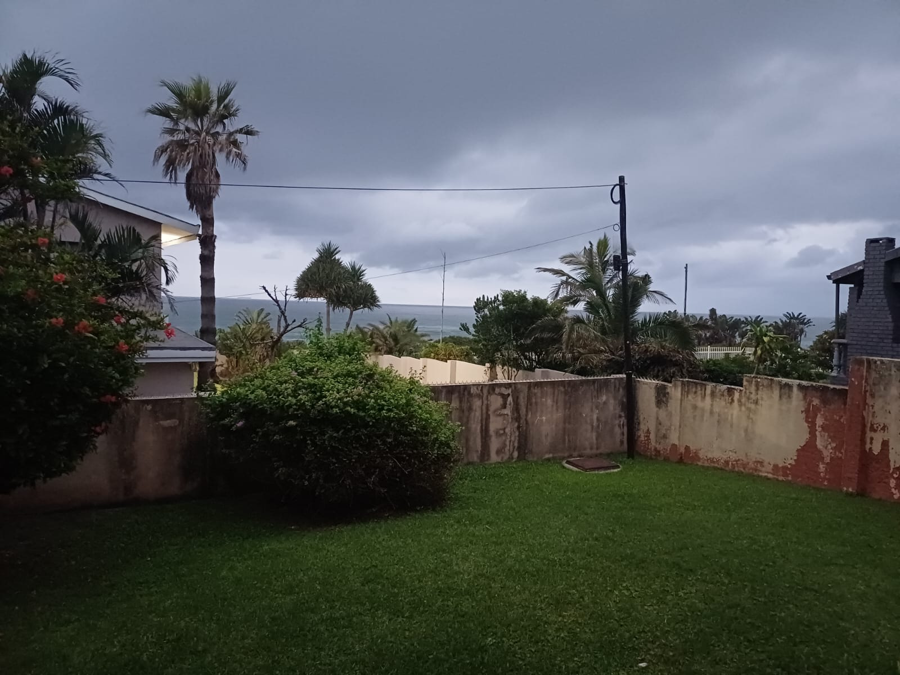
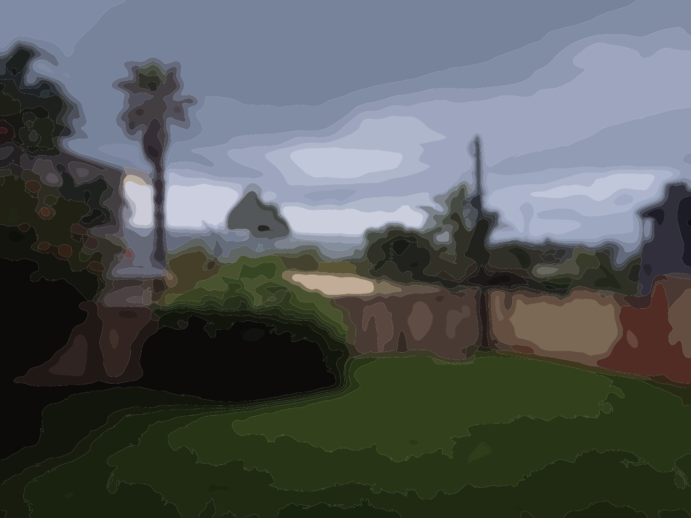
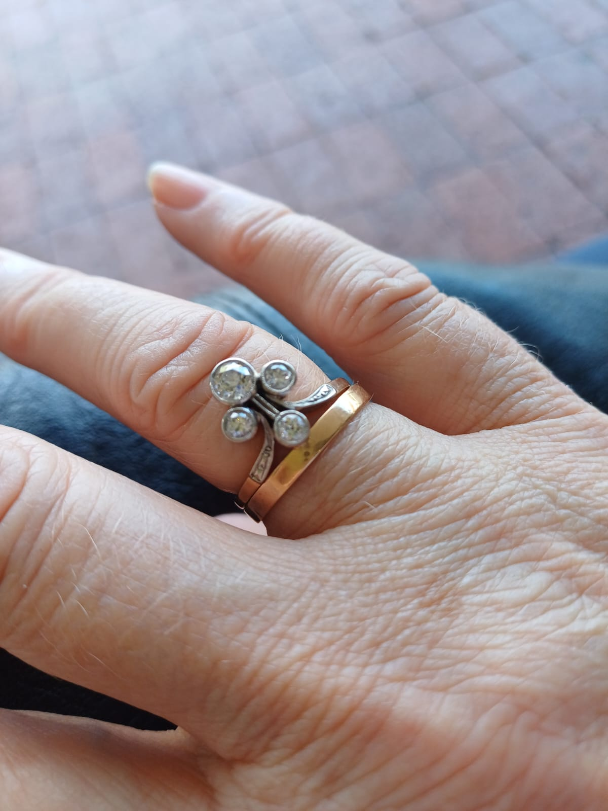
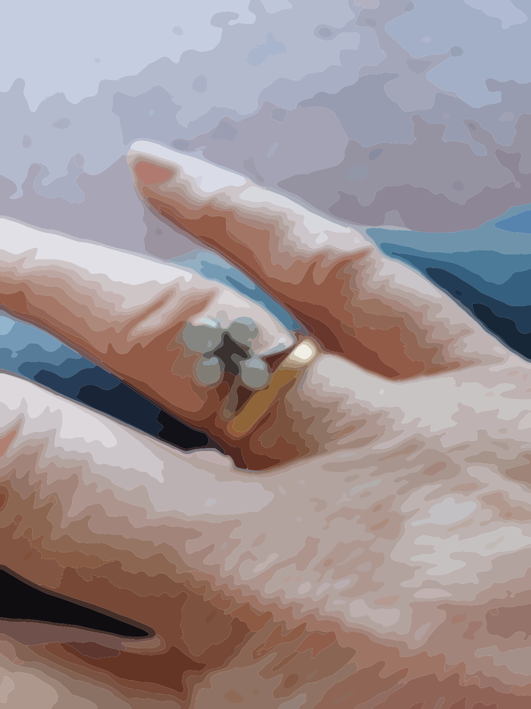

<div align="center">

<!-- BEGIN GENERATED: @partials/hero -->


# Img2Num

_Img2Num_ is a fast and accurate raster vectorizer.

It converts raster images (like PNGs and JPGs) into clean SVGs with _high accuracy and performance_.

<sub>_Img2Num_ is **optimized for natural images**.</sub>


[](https://github.com/Ryan-Millard/Img2Num/actions/workflows/deploy.yml)
[](https://github.com/Ryan-Millard/Img2Num/actions/workflows/release.yml)

[](https://github.com/Ryan-Millard/Img2Num/blob/main/LICENSE)
[](https://github.com/Ryan-Millard/Img2Num/graphs/contributors)
[](https://github.com/Ryan-Millard/Img2Num)
[](https://hub.docker.com/repository/docker/ryanmillard/img2num-dev/general)
[](https://codespaces.new/Ryan-Millard/Img2Num)
[](https://img2num.dev/docs/)
[](https://img2num.dev/changelog/)

[](https://github.com/sponsors/Ryan-Millard)
[](https://github.com/Ryan-Millard/Img2Num/blob/main/SECURITY.md)
[](https://discord.com/invite/BHjxcCqAnU)
<!-- END GENERATED: @partials/hero -->	

## Contents

<table>
<tr>
<td valign="middle">

- [Before vs After](#before-vs-after)
- [Why Img2Num?](#why-img2num)
- [Features](#features)
- [Multi-Language Support](#multi-language-support)
- [Community Links](#community-links)
- [Quick Start](#quick-start)

</td>
<td valign="middle">

- [License](#license)
- [Security](#security)
- [Supporting Us](#supporting-us)
- [Can't find something?](#cant-find-something)
- [Maintainers](#maintainers)
- [Contributors & Credits](#contributors--credits)

</td>
</tr>
</table>

<!-- BEGIN GENERATED: @partials/before-vs-after -->
## Before vs After

| Input (Original Raster) | Output (SVG) |
|----------|------------------|
|  |  |
|  |  |
|  |  |

### What are you waiting for?

Try one of our [example-apps](https://img2num.dev/showcase/)!
<!-- END GENERATED: @partials/before-vs-after -->	

</div>

<!-- BEGIN GENERATED: @partials/why-img2num -->
> [!IMPORTANT]
> ### Why Img2Num?
>
> Most raster-to-SVG vectorizers were designed for clean, synthetic input images such as logos, icons, diagrams, and flat illustrations.
> When applied to real-world photographs, they often struggle with noise, gradients, fine detail, and complex textures, resulting in less accurate vectorizations.
>
> Img2Num takes the opposite approach. It was designed from the ground up for natural images, combining color quantization, contour extraction, and GPU-accelerated processing to produce high-quality SVGs from photographs while still performing well on synthetic artwork.
>
> If your input images are photographs rather than logos or illustrations, Img2Num was built specifically for that use case.
>
> <sub><b>What is Img2Num?</b> Think of tools like [Potrace](https://potrace.sourceforge.net/) or [imagetracerjs](https://github.com/jankovicsandras/imagetracerjs/), but designed with first-class support for natural photographs and other real-world imagery.</sub>
<!-- END GENERATED: @partials/why-img2num -->	

<br />
<br />
<br />

<!-- BEGIN GENERATED: @partials/features -->
## Features

- **Built for real-world photos** - Designed from the ground up to handle natural, noisy raster images (photographs, scans, etc.), unlike many vectorization libraries that are optimized for clean, synthetic source images (icons, logos, flat illustrations).
- **Raster to SVG vectorization** - Converts PNG/JPEG images into clean, layered SVG paths using color quantization, contour tracing, and an integrated SVG writer.
- **GPU-accelerated processing** - Leverages [Dawn](https://dawn.googlesource.com/dawn) (Google's WebGPU implementation) for hardware-accelerated quantization and image processing.
- **Color quantization & palette control** - Reduce an image to any K number of colors (K-Means), with output SVGs organized into logical color groups.
- **Precise contour extraction** - Edge detection and polygon simplification with tunable fidelity for accuracy vs. performance trade-offs.
- [**Multi-language bindings**](#multi-language-support) - Native C++17 core with first-class bindings for:
  - **C** - lightweight C API (add as a submodule)
  - **Python** (`pip install img2num`) - NumPy arrays in, SVG strings out
  - **JavaScript** (`npm i img2num`) - same C++ core compiled to WebAssembly, works in browser and Node
- **WebAssembly-powered** - The native C++ core is compiled to WebAssembly (WASM) for high-performance execution in browsers (JavaScript-only).
- **Zero-copy bindings** - Direct memory access via NumPy in Python and TypedArrays in JS, avoiding unnecessary data copying.
- **Minimal dependencies** - Core library built for speed with only one external runtime dependency (Google's [Dawn](https://dawn.googlesource.com/dawn)).
- **Cross-platform CI** - Tested on Linux, macOS, Windows, and WASM.
- **Flexible distribution** - Available via PyPI, npm, and Docker Hub.
- **Permissive licensing** - MIT-licensed core (libraries, packages, build tools), with AGPLv3 covering docs, example apps, and CI/config - see [below](#license) for details.
<!-- END GENERATED: @partials/features -->	

<!-- BEGIN GENERATED: @partials/multi-language-support -->
## Multi-Language Support

| Language | Package Info |
|-----------:|:------------|
| <a href="https://github.com/Ryan-Millard/Img2Num/releases?q=bindings-c"></a> | <a href="https://github.com/Ryan-Millard/Img2Num/releases?q=bindings-c"></a> [](https://img2num.dev/docs/c/) [](https://img2num.dev/changelog/c/) |
| <a href="https://github.com/Ryan-Millard/Img2Num/releases?q=cpp"></a> | <a href="https://github.com/Ryan-Millard/Img2Num/releases?q=cpp"></a> [](https://img2num.dev/docs/cpp/) [](https://img2num.dev/changelog/cpp/) |
| <a href="https://github.com/Ryan-Millard/Img2Num/releases?q=packages-js"></a> | [](https://www.npmjs.com/package/img2num) [](https://www.jsdelivr.com/package/npm/img2num) [](https://app.unpkg.com/img2num) [](https://www.npmjs.com/package/img2num) <a href="https://github.com/Ryan-Millard/Img2Num/releases?q=packages-js"></a>  [](https://img2num.dev/docs/js/) [](https://img2num.dev/changelog/js/) |
| <a href="https://github.com/Ryan-Millard/Img2Num/releases?q=packages-py"></a> | [](https://pypi.org/project/img2num/) [](https://pypi.org/project/img2num/) [](https://pypi.org/project/img2num/) <a href="https://github.com/Ryan-Millard/Img2Num/releases?q=packages-py"></a> [](https://img2num.dev/docs/py/) [](https://img2num.dev/changelog/py/) |
<!-- END GENERATED: @partials/multi-language-support -->	

<!-- BEGIN GENERATED: @partials/community-links -->
## Community Links

[](https://img2num.dev/changelog/)
[](https://github.com/Ryan-Millard/Img2Num/blob/main/CONTRIBUTING.md)
[](https://github.com/Ryan-Millard/Img2Num/blob/main/SECURITY.md)
[](https://github.com/Ryan-Millard/Img2Num/blob/main/LICENSE)
[](https://github.com/sponsors/Ryan-Millard)
[](https://github.com/Ryan-Millard/Img2Num/issues/views/1151)
[](https://github.com/Ryan-Millard/Img2Num/issues/views/1155)
[](https://img2num.dev/blog/)
[](https://github.com/Ryan-Millard/Img2Num/discussions)
[](https://discord.com/invite/BHjxcCqAnU)
<!-- END GENERATED: @partials/community-links -->	

## Quick Start

### C and C++


- [](https://img2num.dev/docs/c/)
- [](https://img2num.dev/docs/cpp/)

### C Example

<!-- BEGIN GENERATED: example-apps/console-c/main.c -->
```c
#define STB_IMAGE_IMPLEMENTATION
#include <stb/stb_image.h>
#define STB_IMAGE_WRITE_IMPLEMENTATION
#include <cimg2num.h>
#include <errno.h>
#include <stb/stb_image_write.h>
#include <stdint.h>
#include <stdio.h>
#include <stdlib.h>
#include <string.h>
#include <sys/stat.h>

#ifndef OUTPUT_DIR
#define OUTPUT_DIR "./console-c-outputs"
#endif

const int NUM_CHANNELS = 4;
const double SIGMA_WIDTH_RATIO = 0.005;

// Simple mkdir for C (create parents as needed)
int mkdir_recursive(const char* path) {
#ifdef _WIN32
    return _mkdir(path);
#else
    if (mkdir(path, 0755) == 0 || errno == EEXIST)
        return 0;
    return -1;
#endif
}

int main(int argc, char** argv) {
    if (argc < 2) {
        fprintf(stderr, "Usage: %s <image_file>\n", argv[0]);
        return 1;
    }

    // Ensure output directory exists
    if (mkdir_recursive(OUTPUT_DIR) != 0) {
        fprintf(stderr, "Failed to create directory: %s\n", OUTPUT_DIR);
        return 1;
    }

    const char* image_path = argv[1];
    int width, height, channels;

    uint8_t* image_data_original = stbi_load(image_path, &width, &height, &channels, NUM_CHANNELS);
    if (!image_data_original) {
        fprintf(stderr, "Failed to load image: %s\n", stbi_failure_reason());
        return 1;
    }

    printf("Image loaded: %dx%d with %d channel(s).\n", width, height, NUM_CHANNELS);

    size_t img_size = (size_t)width * (size_t)height * (size_t)NUM_CHANNELS;
    size_t labels_size = (size_t)width * (size_t)height * sizeof(int32_t);
    size_t row_stride = (size_t)width * (size_t)NUM_CHANNELS;
    uint8_t* img_data = (uint8_t*)malloc(img_size);
    uint8_t* out_data = (uint8_t*)malloc(img_size);
    int32_t* out_labels = (int32_t*)malloc(labels_size);
    if (!img_data || !out_data || !out_labels) {
        fprintf(stderr, "Failed to allocate memory\n");
        stbi_image_free(image_data_original);
        free(img_data);
        free(out_data);
        free(out_labels);
        return 1;
    }

    memcpy(img_data, image_data_original, img_size);

    // Apply bilateral (C API)
    double sigma = width * SIGMA_WIDTH_RATIO;
    img2num_bilateral_filter(img_data, width, height, sigma, 50.0, 0);
    // Apply kmeans (C API)
    img2num_kmeans(img_data, out_data, out_labels, width, height, 16, 100, 1);
    // Generate SVG
    char* res_svg = img2num_labels_to_svg(img_data, out_labels, width, height, 100, 0);

    img2num_ImageToSvgConfig cfg = img2num_ImageToSvgConfig_default();
    char* res_svg2 = img2num_image_to_svg(image_data_original, width, height, &cfg);

    if (res_svg == NULL) {
        fprintf(stderr, "Failed to generate SVG step-by-step\n");
        stbi_image_free(image_data_original);
        free(img_data);
        free(out_data);
        free(out_labels);
        return 1;
    }

    if (res_svg2 == NULL) {
        fprintf(stderr, "Failed to generate SVG in unified call\n");
        stbi_image_free(image_data_original);
        free(img_data);
        free(out_data);
        free(out_labels);
        return 1;
    }

    // Save outputs
    char out_path[512];
    char kmeans_path[512];
    char svg_path[512];
    snprintf(out_path, sizeof(out_path), "%s/console-c-output.png", OUTPUT_DIR);
    snprintf(kmeans_path, sizeof(kmeans_path), "%s/console-c-kmeans.png", OUTPUT_DIR);
    snprintf(svg_path, sizeof(svg_path), "%s/console-c-svg.svg", OUTPUT_DIR);

    int exit_code = 0;
    const bool blur_save_success =
        stbi_write_png(out_path, width, height, NUM_CHANNELS, img_data, (int)row_stride);
    const bool kmeans_save_success =
        stbi_write_png(kmeans_path, width, height, NUM_CHANNELS, out_data, (int)row_stride);

    FILE* file = fopen(svg_path, "w");
    if (file == NULL) {
        printf("Error: Could not open the file!\n");
        exit_code = 1;
    }

    if (exit_code == 0) {
        fputs(res_svg, file);
        fclose(file);
    }

    if (blur_save_success && kmeans_save_success && (exit_code == 0)) {
        printf(
            "\n\nSUCCESS!\nThe below images have been saved:\n\t- %s\n\t- %s\n\t- %s\n", out_path,
            kmeans_path, svg_path
        );
    } else {
        fprintf(stderr, "Failed to save images!\n");
        exit_code = 1;
    }

    stbi_image_free(image_data_original);
    free(img_data);
    free(out_data);
    free(out_labels);
    free(res_svg);
    free(res_svg2);
    return exit_code;
}
```
<!-- END GENERATED: example-apps/console-c/main.c -->

### C++ Example

<!-- BEGIN GENERATED: example-apps/console-cpp/main.cpp -->
```cpp
#define STB_IMAGE_IMPLEMENTATION
#include <stb/stb_image.h>
#define STB_IMAGE_WRITE_IMPLEMENTATION
#include <cstddef>
#include <cstdint>
#include <cstring>
#include <filesystem>
#include <fstream>
#include <img2num.h>
#include <iostream>
#include <stb/stb_image_write.h>
#include <string>
#include <vector>
#include <thread>

#ifndef OUTPUT_DIR
#define OUTPUT_DIR "./console-cpp-outputs"
#endif

constexpr const char* OUT_DIR {OUTPUT_DIR};

constexpr int NUM_CHANNELS {4};
constexpr double SIGMA_WIDTH_RATIO {0.005};
constexpr int MAX_ITER {100};

void step_by_step(
    uint8_t* image_data_original,
    std::vector<uint8_t>& bilateral_data, 
    std::vector<uint8_t>& kmeans_data,
    int width, int height,
    double sigma_spatial, double sigma_range,
    int k, int max_iter,
    int min_cluster_area, int min_thickness,
    uint8_t color_space,
    std::string& res_svg
){
    const size_t pixel_count {static_cast<size_t>(width) * static_cast<size_t>(height)};
    const size_t byte_count {pixel_count * NUM_CHANNELS};

    std::memcpy(bilateral_data.data(), image_data_original, byte_count);
    std::vector<int32_t> out_labels(pixel_count);

    img2num::bilateral_filter(bilateral_data.data(), width, height, sigma_spatial, sigma_range, color_space);
    // Apply kmeans
    img2num::kmeans(bilateral_data.data(), kmeans_data.data(), out_labels.data(), width, height, k, max_iter, color_space);
    // Generate SVG from labels
    res_svg = img2num::labels_to_svg(bilateral_data.data(), out_labels.data(), width, height, min_cluster_area, min_thickness); 
}

void combined_process(
    uint8_t* image_data_original,
    int width, int height,
    img2num::ImageToSvgConfig& cfg,
    std::string& res_svg
) {
    const size_t pixel_count {static_cast<size_t>(width) * static_cast<size_t>(height)};
    const size_t byte_count {pixel_count * NUM_CHANNELS};

    std::vector<uint8_t> img_data(image_data_original, image_data_original + byte_count);
    res_svg = img2num::image_to_svg(img_data.data(), width, height, cfg);
}

int main(int argc, char** argv) {
    if (argc < 2) {
        std::cerr << "Usage: " << argv[0] << " <image_file>" << std::endl;
        return 1;
    }

    std::string image_path {argv[1]};
    int width {0}, height {0}, channels {0};
    // Force load as RGBA (NUM_CHANNELS = 4)
    uint8_t* image_data_original {
        stbi_load(image_path.c_str(), &width, &height, &channels, NUM_CHANNELS)
    };
    if (!image_data_original) {
        std::cerr << "Failed to load image: " << stbi_failure_reason() << std::endl;
        return 1;
    }

    // Ensure output directory exists
    std::error_code ec;
    std::filesystem::create_directories(OUT_DIR, ec);
    if (ec) {
        std::cerr << "Failed to create directory: " << ec.message() << "\n";
        stbi_image_free(image_data_original);
        return 1;
    }

    const size_t pixel_count {static_cast<size_t>(width) * static_cast<size_t>(height)};
    const size_t byte_count {pixel_count * NUM_CHANNELS};

    std::cout << "Image loaded: " << width << "x" << height << " with " << NUM_CHANNELS
              << " channel(s)." << std::endl;

    // Working copy of the original image
    // std::vector<uint8_t> img_data(image_data_original, image_data_original + byte_count);
    std::vector<uint8_t> img_data(byte_count);
    std::vector<uint8_t> out_data(byte_count);

    std::string res_svg1;
    std::string res_svg2;
    std::string res_svg3;
    std::string res_svg4;


    // Bilateral sigma_spatial
    const double sigma {width * SIGMA_WIDTH_RATIO};

    // Generate SVG with the full pipeline
    img2num::ImageToSvgConfig config;
    config.color_space = 0;
    config.bilateral_filter.sigma_spatial = sigma;
    config.kmeans.k = 32;
    config.min_thickness = 10;

    // Basic example - runs each process one at a time
    step_by_step(
        image_data_original, img_data, 
        out_data, width, height, sigma, 50.0,
        32, 100, 100, 10, 0, res_svg1
    );

    combined_process(image_data_original, width, height, config, res_svg2);

    // Multithreading example - runs processes in parallel with threading
    std::thread t1( 
        step_by_step, image_data_original, 
        std::ref(img_data), std::ref(out_data), width, height, sigma, 50.0,
        32, 100, 100, 10, 0, std::ref(res_svg3)
    );

    std::thread t2(
        combined_process, image_data_original, 
        width, height, std::ref(config), std::ref(res_svg4)
    );

    t1.join();
    t2.join();

    stbi_image_free(image_data_original);

    const std::string bilateral_path {std::string(OUT_DIR) + "/console-cpp-bilateral.png"};
    const std::string kmeans_path {std::string(OUT_DIR) + "/console-cpp-kmeans.png"};
    const std::string svg1_path {std::string(OUT_DIR) + "/console-cpp-svg1.svg"};
    const std::string svg2_path {std::string(OUT_DIR) + "/console-cpp-svg2.svg"};
    const std::string svg3_path {std::string(OUT_DIR) + "/console-cpp-svg3.svg"};
    const std::string svg4_path {std::string(OUT_DIR) + "/console-cpp-svg4.svg"};

    const bool bilateral_save_success {
        stbi_write_png(
            bilateral_path.c_str(), width, height, NUM_CHANNELS, img_data.data(),
            width * NUM_CHANNELS
        ) == 1
    };
    const bool kmeans_save_success {
        stbi_write_png(
            kmeans_path.c_str(), width, height, NUM_CHANNELS, out_data.data(), width * NUM_CHANNELS
        ) == 1
    };

    auto write_text = [](const std::string& path, const std::string& content) {
        std::ofstream file(path);
        if (!file.is_open()) {
            std::cerr << "Error: Could not open " << path << std::endl;
            return false;
        }
        file << content;
        file.close();
        return !file.fail();
    };
    const bool svg1_save_success {write_text(svg1_path, res_svg1)};
    const bool svg2_save_success {write_text(svg2_path, res_svg2)};
    const bool svg3_save_success {write_text(svg3_path, res_svg3)};
    const bool svg4_save_success {write_text(svg4_path, res_svg4)};

    if (
        bilateral_save_success && kmeans_save_success && 
        svg1_save_success && svg2_save_success &&
        svg3_save_success && svg4_save_success
    ) {
        std::cout << "\n\nSUCCESS!\nThe below images have been saved:\n\t- " << bilateral_path
                  << "\n\t- " << kmeans_path << "\n\t- " << svg1_path << "\n\t- " << svg2_path
                  << "\n\t- " << svg3_path << "\n\t- " << svg4_path
                  << std::endl;
        return 0;
    }

    std::cerr << "Failed to save images!" << std::endl;
    return 1;
}
```
<!-- END GENERATED: example-apps/console-cpp/main.cpp -->

### JavaScript


For more detailed information on installing this package, please refer to [our documentation](https://img2num.dev/docs/js/):

#### CDN

[](https://www.jsdelivr.com/package/npm/img2num)
[](https://app.unpkg.com/img2num)

```html
<!-- IMPORTANT: this is browser-only -->
<script src="https://cdn.jsdelivr.net/npm/img2num@0.3.0/dist/browser/img2num.js"></script>
```

#### Package Manager

##### Install Img2Num from npm

```sh
npm install img2num
```

##### Import the Img2Num package

- **ES6:**
    ```js
    import { imageToSvg } from "img2num";
    ```
- **CommonJS:**
    ```js
    const { imageToSvg } = require("img2num");
    ```

### Python


For more detailed information on installing this package, please refer to [our documentation](https://img2num.dev/docs/py/).

#### Install Img2Num using pip

```sh
pip install img2num
```

#### Import Img2Num

```py
from img2num import image_to_svg
```

#### Use Img2Num from the command line

> [!IMPORTANT]
> PyPI version `0.3.1` does not include the `cli` extra or the `img2num` command.
> CLI installation from PyPI must wait for a release containing both. The examples below require the CLI built from repository source.

Follow the [CLI guide](docs/docs/py/cli.md#installation) to install from source in the Docker development environment. Then convert images without writing Python code:

```sh
img2num input.png -o output.svg
img2num photos/ -o out/
img2num --help
```

The plain `pip install img2num` command remains sufficient for library use.
See the [CLI guide](docs/docs/py/cli.md) for more examples, options, and troubleshooting.

<!-- BEGIN GENERATED: @partials/license -->
## License

This package (the library you install) is [MIT-licensed](https://github.com/Ryan-Millard/Img2Num/blob/main/LICENSE).
Documentation, example apps, and CI/config in the main repository are AGPLv3.

> Prior to [#250](https://github.com/Ryan-Millard/Img2Num/pull/250), the project used AGPLv3.
> The core library was relicensed to MIT to make it easier to embed in commercial and
> closed-source projects, while documentation, example apps, and CI/config retained AGPLv3 to discourage
> unattributed reuse of project infrastructure that isn't part of the redistributable library itself.

For more information, refer to the [`REUSE.toml` file](https://github.com/Ryan-Millard/Img2Num/blob/main/REUSE.toml).
<!-- END GENERATED: @partials/license -->

<!-- BEGIN GENERATED: @partials/security -->
## Security

[](SECURITY.md)

Found a vulnerability? Please **do not** open a public issue.

Report it privately by following our [Security Policy](SECURITY.md).
<!-- END GENERATED: @partials/security -->

<!-- begin generated: @partials/supporting-us -->
<!-- end generated: @partials/supporting-us -->

<!-- BEGIN GENERATED: @partials/cant-find-something -->
## Can't find something?

If you need something, see [our documentation](https://img2num.dev/docs/) or check our [FAQ](https://img2num.dev/faq/).

If you can't find it, feel free to open an [issue](https://github.com/Ryan-Millard/Img2Num/issues/new) to request assistance with finding or creating what you need.
Alternatively, ask us on [Discord](https://discord.com/invite/BHjxcCqAnU)!
<!-- END GENERATED: @partials/cant-find-something -->

<!-- BEGIN GENERATED: @partials/footer -->
## Maintainers

[](https://github.com/Ryan-Millard)
[](https://github.com/krasner)
[](https://github.com/Prachi-Gupta2808)

---

<div align="center">

<p>
  <a href="https://github.com/Ryan-Millard/Img2Num">GitHub</a>
  &middot;
  <a href="https://img2num.dev/docs/">Documentation</a>
  &middot;
  <a href="https://img2num.dev/changelog/">Changelog</a>
  &middot;
  <a href="https://github.com/Ryan-Millard/Img2Num/blob/main/CONTRIBUTING.md">Contributing</a>
  &middot;
  <a href="https://github.com/Ryan-Millard/Img2Num/blob/main/SECURITY.md">Security</a>
  &middot;
  <a href="https://github.com/sponsors/Ryan-Millard">Sponsor</a>
  &middot;
  <a href="https://github.com/Ryan-Millard/Img2Num/issues">Issues</a>
  &middot;
  <a href="https://github.com/Ryan-Millard/Img2Num/discussions">Discussions</a>
  &middot;
  <a href="https://img2num.dev/blog/">Blog</a>
</p>

<p>
  Thanks to all of our contributors:

  <a href="https://github.com/Ryan-Millard/Img2Num/graphs/contributors">
    
  </a>
</p>
</div>
<!-- END GENERATED: @partials/footer -->
