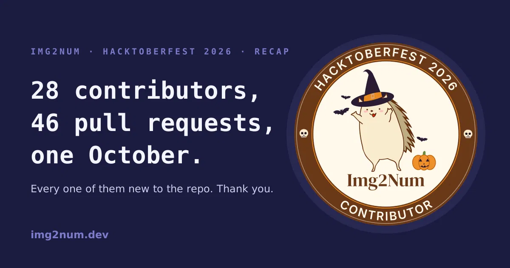
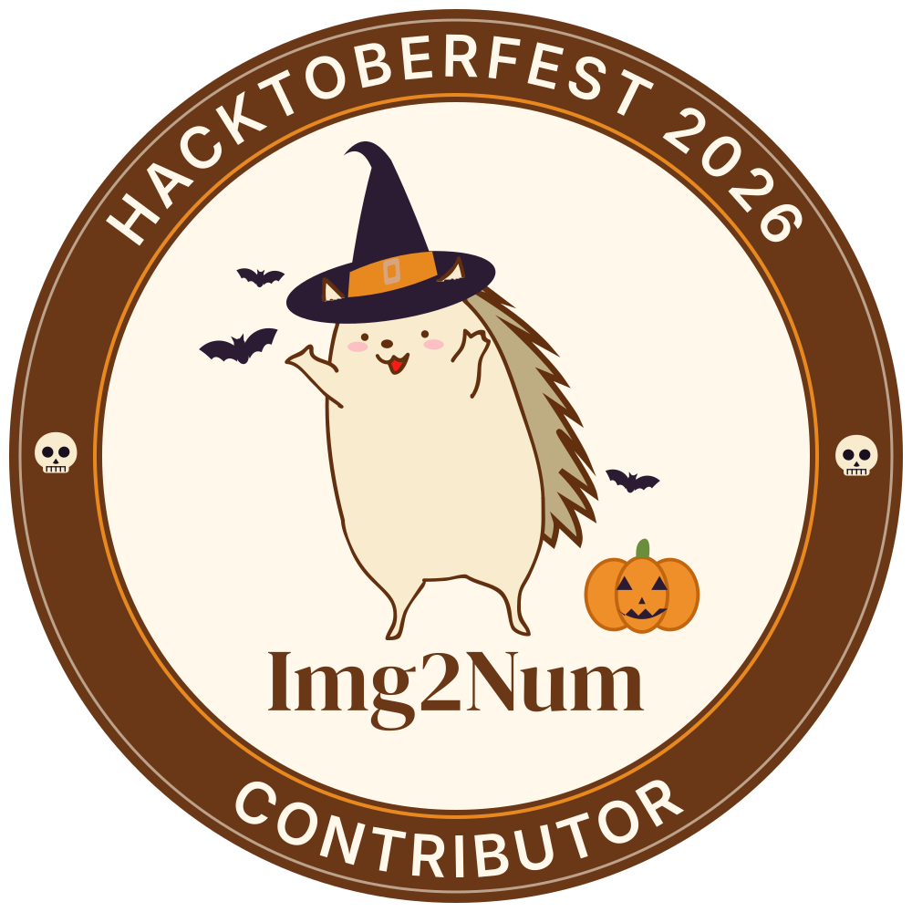
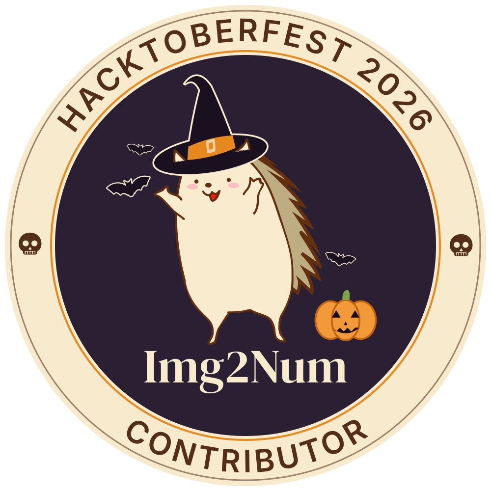

# Hacktoberfest 2026: 28 first-time contributors, 46 merged pull requests 🦔

URL: https://img2num.dev/blog/hacktoberfest-2026-recap

November 8, 2026 · 13 min read
 Ryan Millard
Img2Num Author

At the end of September weasked you to contribute to Img2Num this Hacktoberfest , and we were upfront about the deal: Hacktoberfest 2026 stopped counting pull requests, so there was no counter to climb and no t-shirt at the end of it. A reviewed and merged pull request in a real project was the whole prize and

**twenty-eight of you took it!**Between 3 and 30 October we merged **46 pull requests from 28 contributors** . None of the contributors had contributed to Img2Num before October. They fixed output bugs in the C++ core, made the Python bindings release the GIL, gave the npm package TypeScript types, rebuilt pages of this site, and deleted more than 1 300 lines of code that was no longer needed. Every one of them is now listed on theHacktoberfest 2026 event page , along with their pull requests.

This post is the long version that explains what got built, what it changed, and what happens next.

## The numbers

- **28 contributors** , every one of them merging into Img2Num for the first time. [GitHub's contributor graph for October](https://github.com/Ryan-Millard/Img2Num/graphs/contributors?from=2026-10-01&to=2026-10-31&type=c) has the same names.
- **46 pull requests merged** between 3 and 30 October ( [the full list on GitHub](https://github.com/Ryan-Millard/Img2Num/pulls?q=is%3Apr%20is%3Amerged%20merged%3A2026-10-01..2026-10-31%20-author%3ARyan-Millard%20-author%3Akrasner%20-author%3APrachi-Gupta2808) ). Maintainers' own pull requests (five, including the new CLI) are not counted.
- **177 files changed, +5 232 , and −2 959 lines.**
- **At least 29 issues closed** by those pull requests.
- **Under four days** from opening a pull request to merging it, at the median. Twelve merged within a day; 37 of the 46 within a week.
- **10 contributors opened more than one pull request.** Three of them, [@Lothnic](https://github.com/Lothnic) , [@saptadeep12](https://github.com/saptadeep12) , and [@nitin-kumar-code](https://github.com/nitin-kumar-code) opened five each.

## What got built

This section groups the changes according to where they were made in the project. Pull request numbers link to GitHub, and theevent page has the same work grouped by person.

### C++ core and GPU (8)

- **A reusable WebGPU helper layer** - [#658](https://github.com/Ryan-Millard/Img2Num/pull/658) by [@siddharth1407](https://github.com/siddharth1407) . RAII wrappers over Dawn ( `gpu::Buffer<T>` , `gpu::Texture` , bind-group and compute-pass helpers), then both GPU kernels ported onto them: the bilateral filter went from 313 lines to 120 with identical behaviour. [#694](https://github.com/Ryan-Millard/Img2Num/pull/694) documented the new layer the same week.
- **Two more ways to fall back to the CPU** - [#663](https://github.com/Ryan-Millard/Img2Num/pull/663) by [@ayusharora07](https://github.com/ayusharora07) stops the WebGPU device being initialised twice and falls back when device creation fails; [#696](https://github.com/Ryan-Millard/Img2Num/pull/696) by [@BhoomiMahna](https://github.com/BhoomiMahna) does the same when the only adapter Dawn can find is the Null backend. A machine without a usable GPU now gets the CPU path instead of a failed conversion.
- **Correct output at the edges** - [#659](https://github.com/Ryan-Millard/Img2Num/pull/659) by [@RahulKumarBaldia](https://github.com/RahulKumarBaldia) . `gaussian_blur_fft` now uses reflect padding, which fixes darkened borders and content wrapping around from the opposite edge.
- **k-means with k = 1** - [#682](https://github.com/Ryan-Millard/Img2Num/pull/682) by [@nitin-kumar-code](https://github.com/nitin-kumar-code) fixed the CPU path's output when there is only one cluster. A two-line change; wrong output before, right output after.
- **Fewer run-to-run differences** - [#765](https://github.com/Ryan-Millard/Img2Num/pull/765) by [@saptadeep12](https://github.com/saptadeep12) orders each graph node's neighbours by id, so the contour graph no longer depends on the order they happened to be inserted in.
- **`ptr` became `image`** - [#749](https://github.com/Ryan-Millard/Img2Num/pull/749) by [@MiyaMango](https://github.com/MiyaMango) renamed the parameter across the C++ core, the C ABI and the JavaScript glue. Small, and the API reference reads better now!
- **157 lines of unreachable contour-tracing code removed** - [#768](https://github.com/Ryan-Millard/Img2Num/pull/768) by [@shivangmathur2008-stack](https://github.com/shivangmathur2008-stack) , with the matching internal docs.
Most of this shipped in [cpp 0.3.0](https://github.com/Ryan-Millard/Img2Num/releases/tag/cpp-v0.3.0) and [bindings-c 0.2.1](https://github.com/Ryan-Millard/Img2Num/releases/tag/bindings-c-v0.2.1) on 23 October.

### Python (6)

- **The GIL is released while the C++ core runs** - [#777](https://github.com/Ryan-Millard/Img2Num/pull/777) by [@Lothnic](https://github.com/Lothnic) . Python threads that call Img2Num now run the native work in parallel instead of taking turns, and the console example gained a two-worker `ThreadPoolExecutor` demo to prove it. [Krasner](https://github.com/Krasner) 's [#784](https://github.com/Ryan-Millard/Img2Num/pull/784) built on it a week later to make the GPU path parallel too.
- **`img2num.__version__`** - [#758](https://github.com/Ryan-Millard/Img2Num/pull/758) , and **Python 3.13** declared in the package classifiers - [#754](https://github.com/Ryan-Millard/Img2Num/pull/754) , both by [@Lothnic](https://github.com/Lothnic) .
- **Typos in config are errors now** - [#766](https://github.com/Ryan-Millard/Img2Num/pull/766) by [@IvanGiovany](https://github.com/IvanGiovany) : an unknown key in `ImageToSvgConfig` raises `TypeError` .
- **A one-line fix for a double move** - [#665](https://github.com/Ryan-Millard/Img2Num/pull/665) by [@Gracy769](https://github.com/Gracy769) removed a `std::move` that moved the SVG string twice in `labels_to_svg` .
- **Wheels carry only the Python component** - [#767](https://github.com/Ryan-Millard/Img2Num/pull/767) by [@Farhan-Alam-Jamal](https://github.com/Farhan-Alam-Jamal) scoped the CMake install to the `python` component, so wheels stop picking up files that belong to other parts of the build.
None of this is on PyPI yet - the current release is 0.3.1. It ships with the next Python release, together with the new`img2num` command-line tool that [Krasner](https://github.com/Krasner) built in [#703](https://github.com/Ryan-Millard/Img2Num/pull/703) and [@Adithya6721](https://github.com/Adithya6721) documented in [#801](https://github.com/Ryan-Millard/Img2Num/pull/801) .

### JavaScript and C (2)

- **TypeScript declarations for the npm package** - [#670](https://github.com/Ryan-Millard/Img2Num/pull/670) by [@saptadeep12](https://github.com/saptadeep12) . The declarations are generated from tightened JSDoc with `tsc --allowJs --declaration` , so the JSDoc stays the single source of truth; `types` comes first in every `exports` branch; and a strict-mode `tsc --noEmit` type test runs in CI so they cannot drift. Ships in the next npm release.
- **The C error API got real prototypes** - [#764](https://github.com/Ryan-Millard/Img2Num/pull/764) by [@Ayushrawatcy009](https://github.com/Ayushrawatcy009) . In C, `img2num_get_last_error()` declares a function taking unspecified arguments; `img2num_get_last_error(void)` is a prototype. Shipped in bindings-c 0.2.1.

### Example apps (7)

- The React example's **Vitest suite runs again** - [#713](https://github.com/Ryan-Millard/Img2Num/pull/713) by [@Lothnic](https://github.com/Lothnic) . It also lost **1,370 lines** of About and credits pages that had nothing to do with the library - [#789](https://github.com/Ryan-Millard/Img2Num/pull/789) by [@mrunalC27](https://github.com/mrunalC27) ; its `/credits` redirect now points at theHall of Fame - [#793](https://github.com/Ryan-Millard/Img2Num/pull/793) by [@slopgobblercobbler](https://github.com/slopgobblercobbler) ; and it has a README - [#660](https://github.com/Ryan-Millard/Img2Num/pull/660) by [@PrathamRanka](https://github.com/PrathamRanka) .
- The console apps: the Python one **validates its image input** - [#661](https://github.com/Ryan-Millard/Img2Num/pull/661) by [@PrathamRanka](https://github.com/PrathamRanka) ; the C++ one was **tidied up** - [#687](https://github.com/Ryan-Millard/Img2Num/pull/687) by [@saptadeep12](https://github.com/saptadeep12) ; and the Node ones (ESM and CJS) have a **correct usage message and an output-path option** - [#677](https://github.com/Ryan-Millard/Img2Num/pull/677) by [@Astrolyte](https://github.com/Astrolyte) .

### Docs and this website (15)

- **The Hall of Fame** - [#679](https://github.com/Ryan-Millard/Img2Num/pull/679) by [@08abhinav](https://github.com/08abhinav) . The page that honours contributors was itself built by a first-time contributor: a data file of featured members, GitHub profile and merged-PR data fetched at build time, bot filtering, and fallbacks so an API hiccup cannot break the build. Theevents pages sit on top of it.
- **The Showcase** - [#644](https://github.com/Ryan-Millard/Img2Num/pull/644) by [@dr-nullptr](https://github.com/dr-nullptr) turned the example-apps index into/showcase , with a "Built with Img2Num" section for third-party projects and asubmission page that opens a prefilled Discussion.
- **The FAQ** redesigned with accordions - [#623](https://github.com/Ryan-Millard/Img2Num/pull/623) by [@flodrick](https://github.com/flodrick) ; **Core Concepts became a glossary** - [#646](https://github.com/Ryan-Millard/Img2Num/pull/646) by [@FathimaManal](https://github.com/FathimaManal) ; **Discord** in the navbar, footer and contributing guide - [#689](https://github.com/Ryan-Millard/Img2Num/pull/689) by [@saptadeep12](https://github.com/saptadeep12) ; **site styles and the navbar blur** fixed - [#680](https://github.com/Ryan-Millard/Img2Num/pull/680) by [@thilakshan2003](https://github.com/thilakshan2003) ; **"Edit this page" links point at `dev`** - [#770](https://github.com/Ryan-Millard/Img2Num/pull/770) by [@satyaharendrarushidayaka-sudo](https://github.com/satyaharendrarushidayaka-sudo) .
- **Docs that match the code** : `min_thickness` defaults documented - [#655](https://github.com/Ryan-Millard/Img2Num/pull/655) by [@Yipjunwei](https://github.com/Yipjunwei) ; `black_threshold_image` described as the per-channel brightness cutoff it is, in the C++ header, the Python docstring and the docs - [#692](https://github.com/Ryan-Millard/Img2Num/pull/692) by [@Lothnic](https://github.com/Lothnic) ; the `gpu_utils` layer documented - [#694](https://github.com/Ryan-Millard/Img2Num/pull/694) by [@siddharth1407](https://github.com/siddharth1407) ; the Debug Logging guide rewritten to match the actual code - [#771](https://github.com/Ryan-Millard/Img2Num/pull/771) by [@Ayushrawatcy009](https://github.com/Ayushrawatcy009) ; the swapped C and JavaScript rows in the API bindings tables - [#762](https://github.com/Ryan-Millard/Img2Num/pull/762) by [@mayanksingh-7974](https://github.com/mayanksingh-7974) ; the synchronous-API migration guidance in our own blog post corrected - [#760](https://github.com/Ryan-Millard/Img2Num/pull/760) by [@jazayush](https://github.com/jazayush) ; what happens when several people claim one issue, in the contributing guide - [#795](https://github.com/Ryan-Millard/Img2Num/pull/795) by [@saptadeep12](https://github.com/saptadeep12) ; and the newCLI guide - [#801](https://github.com/Ryan-Millard/Img2Num/pull/801) by [@Adithya6721](https://github.com/Adithya6721) .

### Build, CI and tooling (8)

- **CMake pinned** in `.versions/cmake.json` , with the minimum version derived from it - [#666](https://github.com/Ryan-Millard/Img2Num/pull/666) by [@Farhan-Alam-Jamal](https://github.com/Farhan-Alam-Jamal) .
- **A Docker build command** in the dev script - [#669](https://github.com/Ryan-Millard/Img2Num/pull/669) by [@thisisparth187](https://github.com/thisisparth187) .
- **The justfile split into modules** - [#695](https://github.com/Ryan-Millard/Img2Num/pull/695) by [@mrunalC27](https://github.com/mrunalC27) , with the console binary paths corrected afterwards - [#750](https://github.com/Ryan-Millard/Img2Num/pull/750) by [@Yipjunwei](https://github.com/Yipjunwei) .
- **Stray dependencies removed** from the root and dev-scripts packages - [#759](https://github.com/Ryan-Millard/Img2Num/pull/759) , and `validate-scripts` handling an optional `_meta.ignore` - [#774](https://github.com/Ryan-Millard/Img2Num/pull/774) , both by [@mayanksingh-7974](https://github.com/mayanksingh-7974) .
- **CI cancels superseded runs** when you push again to an open pull request - [#757](https://github.com/Ryan-Millard/Img2Num/pull/757) by [@nitin-kumar-code](https://github.com/nitin-kumar-code) .
- **111 lines of dead release workflow removed** - [#799](https://github.com/Ryan-Millard/Img2Num/pull/799) by [@mrunalC27](https://github.com/mrunalC27) .

## The badge

 If your name is on theevent page , this is yours. It comes as SVG and PNG in light and dark versions, with ready-made Markdown and HTML snippets for a README or a profile, and a credential URL you can paste into LinkedIn's *Licenses & certifications* . Everything is at the top of theevent page .

Hacktoberfest did not count pull requests toward rewards this year. We thought 28 first merged pull requests deserved something you can keep.

## How it went from our side

A few things we noticed reviewing 46 pull requests in a month:

- **The first three days set the pace.** Fourteen pull requests were opened on 1–3 October, on top of three that had been waiting since the last days of September. By 11 October, 20 had merged.
- **Small and specific merged fastest.** Twelve pull requests merged within a day of being opened, and each of them did one clearly described thing. A good title and a `Fixes #...` line are most of the work of getting reviewed quickly.
- **Big changes landed too.** The GIL release, the TypeScript declarations and the WebGPU helper layer were each several hundred lines, and all three changed what the library can do. This was not a month of typo fixes.
- **Deleting is contributing.** More than a third of the changed lines were deletions. The biggest pull request of the month by lines, [#789](https://github.com/Ryan-Millard/Img2Num/pull/789) , removed 1,370 of them.
- **People stayed.** Ten of the 28 opened more than one pull request.
Thanks to [Krasner](https://github.com/Krasner) , who reviewed and co-authored several of these and shipped the CLI ( [#703](https://github.com/Ryan-Millard/Img2Num/pull/703) ) and truly parallel GPU execution ( [#784](https://github.com/Ryan-Millard/Img2Num/pull/784) ) in between, and to [Prachi](https://github.com/Prachi-Gupta2808) , who wrotethe post that started it and posted about it on [LinkedIn](https://lnkd.in/p/g4Xh3KbQ) .

## What's next

- **Releases.** cpp 0.3.0 and bindings-c 0.2.1 are out with the core and C work. The Python and JavaScript work above - the GIL release, `__version__` , the `TypeError` , Python 3.13, the TypeScript declarations and the CLI - ships in the next PyPI and npm releases.
- **The October cohort is not done.**[@BhoomiMahna](https://github.com/BhoomiMahna) 's [#702](https://github.com/Ryan-Millard/Img2Num/pull/702) , adding C++ and C ABI test coverage, merged on 4 November - the first post-Hacktoberfest pull request from someone who started in October. We hope for far more!
- **Discord.** Contributors get the Contributor role and the private channel. Post your GitHub username in [Discord](https://discord.gg/BHjxcCqAnU) and we will match it to the list.
- **You do not have to wait for next October.** The [good first issues](https://github.com/Ryan-Millard/Img2Num/issues/views/MDI0OlJlcG9zaXRvcnlTZWFyY2hTaG9ydGN1dDExNTU%3D) are still there, and so are we.
Thank you, all 28 of you. 🦔

**Tags:**
- Hacktoberfest - Community - Open Source - Contributing
