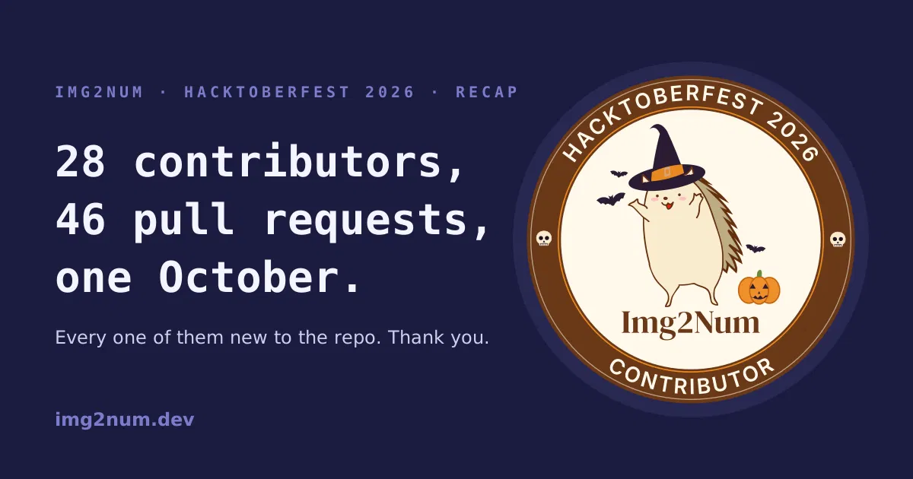

# Documentation Page

URL: https://img2num.dev/blog/tags/open-source

## Hacktoberfest 2026: 28 first-time contributors, 46 merged pull requests 🦔

November 8, 2026 · 13 min read
 Ryan Millard
Img2Num Author

At the end of September weasked you to contribute to Img2Num this Hacktoberfest , and we were upfront about the deal: Hacktoberfest 2026 stopped counting pull requests, so there was no counter to climb and no t-shirt at the end of it. A reviewed and merged pull request in a real project was the whole prize and

**twenty-eight of you took it!**Between 3 and 30 October we merged **46 pull requests from 28 contributors** . None of the contributors had contributed to Img2Num before October. They fixed output bugs in the C++ core, made the Python bindings release the GIL, gave the npm package TypeScript types, rebuilt pages of this site, and deleted more than 1 300 lines of code that was no longer needed. Every one of them is now listed on theHacktoberfest 2026 event page , along with their pull requests.

This post is the long version that explains what got built, what it changed, and what happens next.

**Tags:**
- Hacktoberfest - Community - Open Source - Contributing

**Read more**
