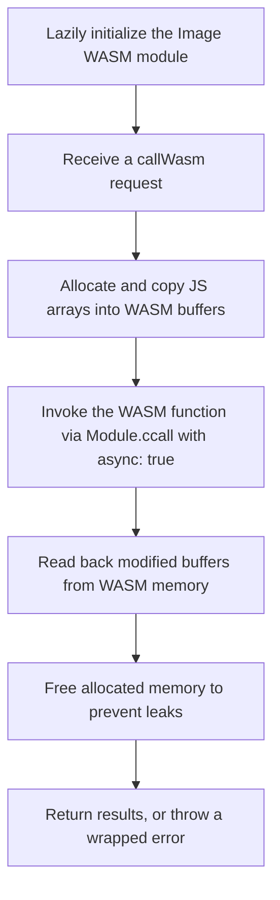

[`wasmClient.js`](https://github.com/Ryan-Millard/Img2Num/tree/main/packages/js/src/wasmClient.js) exposes
`callWasm`, the low-level bridge between JavaScript and the **Image WASM module**.

Calls run on the thread that invokes them — there is no Web Worker. `callWasm`
allocates WASM memory for buffer arguments, marshals JavaScript values into the
WASM heap, invokes the exported function asynchronously, reads modified buffers
and return values back into JavaScript, and frees every allocation.

:::tip JS-to-WASM Memory
All data is copied between JavaScript and WASM - this avoids unexpected use-after-free bugs in JS.

| Language   | Memory type                    | Data supplier                                                                                                                                      | Who manages it                |
| ---------- | ------------------------------ | -------------------------------------------------------------------------------------------------------------------------------------------------- | ----------------------------- |
| JavaScript | Detached Copy of WASM data     | [`wasmClient.js`](https://github.com/Ryan-Millard/Img2Num/tree/main/packages/js/src/wasmClient.js): copies return & out parameter values to JS variables | Garbage Collector (automatic) |
| WASM (C++) | Linear Independent WASM memory | [`wasmClient.js`](https://github.com/Ryan-Millard/Img2Num/tree/main/packages/js/src/wasmClient.js): copies args & bufferKeys to WASM memory              | Programmer (manual)           |

:::

## Overview

### Key responsibilities

import Tabs from "@theme/Tabs";
import TabItem from "@theme/TabItem";

<Tabs groupId="wasm-client" defaultValue="flow">
<TabItem value="flow" label="Flow diagram">

<div>



</div>

</TabItem>

<TabItem value="overview" label="Overview">

- Lazily initialize the **Image WASM module** on the first call ([`wasmModule.js`](https://github.com/Ryan-Millard/Img2Num/tree/main/packages/js/src/wasmModule.js)).
- Accept a `callWasm` request describing:
  - The exported function to call in WASM (`funcName`).
  - Arguments to pass (`args`), including TypedArrays.
  - Which arguments are buffers needing allocation (`bufferKeys`).
  - The expected `returnType`.
- Allocate and copy memory for JS arrays into WASM.
- Invoke the WASM function asynchronously ([`ccall.js`](https://github.com/Ryan-Millard/Img2Num/tree/main/packages/js/src/ccall.js)).
- Read back any modified buffers from WASM memory.
- Free allocated memory to prevent leaks.
  - This keeps the code written in JavaScript looking more like JavaScript and prevents forgotten memory frees.
- Return results to the caller, or throw a wrapped error.

</TabItem>
</Tabs>

## TypedArray and Value Handling (`WASM_TYPES`)

[`wasmTypes.js`](https://github.com/Ryan-Millard/Img2Num/tree/main/packages/js/src/wasmTypes.js)
defines a centralized type registry so allocation and readback are handled
consistently. Each handler fetches the current module with `getWasmModule()`.

```js title="WASM_TYPES registry (wasmTypes.js)"
export const WASM_TYPES = {
  void: {
    alloc: () => null,
    read: () => undefined,
  },

  Int32Array: {
    alloc: (arr) => {
      const wasmModule = getWasmModule();
      const ptr = wasmModule._malloc(arr.byteLength);
      wasmModule.HEAP32.set(arr, ptr >> 2);
      return ptr;
    },
    read: (ptr, len) => {
      const wasmModule = getWasmModule();
      return new Int32Array(wasmModule.HEAP32.buffer, ptr, len).slice();
    },
  },

  Uint8Array: {
    alloc: (arr) => {
      const wasmModule = getWasmModule();
      const ptr = wasmModule._malloc(arr.byteLength);
      wasmModule.HEAPU8.set(arr, ptr);
      return ptr;
    },
    read: (ptr, len) => {
      const wasmModule = getWasmModule();
      return wasmModule.HEAPU8.slice(ptr, ptr + len);
    },
  },

  Uint8ClampedArray: {
    alloc: (arr) => {
      const wasmModule = getWasmModule();
      const ptr = wasmModule._malloc(arr.byteLength);
      wasmModule.HEAPU8.set(arr, ptr);
      return ptr;
    },
    read: (ptr, len) => {
      const wasmModule = getWasmModule();
      return new Uint8ClampedArray(wasmModule.HEAPU8.slice(ptr, ptr + len));
    },
  },

  string: {
    alloc: (str) => {
      const wasmModule = getWasmModule();
      const len = wasmModule.lengthBytesUTF8(str) + 1;
      const ptr = wasmModule._malloc(len);
      wasmModule.stringToUTF8(str, ptr, len);
      return ptr;
    },
    read: (ptr) => {
      const wasmModule = getWasmModule();
      return ptr ? wasmModule.UTF8ToString(ptr) : null;
    },
  },
};
```

### Why this design?

- One authoritative place for allocation and readback logic
- Easy to add new types safely
- Prevents mismatched heap usage
- Keeps JS-side code declarative
  - TypeScript offers limited benefit here: all values decay to raw pointers and integers at the C ABI boundary, so runtime handling must be explicit.

:::danger Danger: Adding New WASM_TYPES
Memory received from WASM is raw and untyped. Returned values are typically integers (often pointers) and must be interpreted explicitly.

See the [Adding New WASM_TYPES](#adding-new-wasm_types) section below to learn how to read new types safely.
:::

## Memory Allocation for Arguments and Out Parameters

### Optional Buffer Keys

A `callWasm` request **optionally** specifies `bufferKeys` as structured descriptors:

```js title="Arguments passed to the WASM function"
args: {
  pixels,
  labels,
  width,
  height,
  min_area,
}
```

```js title="Arguments that represent buffers (C++ arrays)"
bufferKeys: [
  { key: "pixels", type: "Uint8ClampedArray" },
  { key: "labels", type: "Int32Array" },
];
```

:::important
The `key` values in `bufferKeys` must exactly match the name of the argument given in JS.

> The names given to `args` do not need to match the names in the definition of the C++ function.
> :::

### Allocation Flow

```js title="Loop over bufferKeys (wasmClient.js)"
for (const { key, type } of bufferKeys) {
  const handler = WASM_TYPES[type];

  if (!handler) {
    throw new Error(`Unsupported type: ${type}`);
  }

  const value = argsMap.get(key);
  const ptr = handler.alloc(value);

  pointers.set(key, { ptr, type, length: value?.length });
  argsMap.set(key, ptr);
}
```

- Rejects unknown types with `Unsupported type: <type>`
- Allocates memory via `_malloc`
- Copies JS data into the correct WASM heap
- Replaces JS values with raw pointers (in the `argsMap`)
- Tracks all allocations (in `pointers`) for guaranteed cleanup
  - Memory freed in the `finally` block

## WASM Function Call

Invocation is delegated to `ccallAsync`
([`ccall.js`](https://github.com/Ryan-Millard/Img2Num/tree/main/packages/js/src/ccall.js)),
which calls Emscripten's `Module.ccall` in asynchronous mode:

```js title="Invoke the export (wasmClient.js)"
const result = await ccallAsync(funcName, argsMap, returnType);
```

```js title="ccallAsync (ccall.js)"
export async function ccallAsync(funcName, argsMap, returnType) {
  const wasmModule = getWasmModule();

  const argTypes = Array(argsMap.size).fill("number");
  const retType = returnType === "void" ? null : "number";

  return wasmModule.ccall(funcName, retType, argTypes, [...argsMap.values()], { async: true });
}
```

- All arguments cross the C ABI boundary as numbers (buffer arguments are pointers).
- `retType` is `null` for `void`, otherwise `"number"` (a value or pointer that a `WASM_TYPES` handler later interprets).
- `{ async: true }` lets the call integrate with Emscripten's asynchronous runtime.
- `argsMap` preserves insertion order; callers must construct `args` in the exact order expected by the C++ signature.

## Reading Back Buffers and Return Values

### Buffers (Out Parameters)

```js title="Read each buffer back into a detached JS copy"
const output = Object.create(null);

for (const { key, type } of bufferKeys) {
  const { ptr, length } = pointers.get(key);
  output[key] = WASM_TYPES[type].read(ptr, length);
}
```

- `.slice()` (inside the `read` handlers) ensures the data is detached from WASM memory.
- JS always receives GC-managed copies.

### Returned Values

```js title="Interpret the return value by its logical type"
let returnValue = result;

if (returnType !== "void") {
  returnValue = WASM_TYPES[returnType].read(result);
}

if (returnType === "string" && result) {
  wasmModule._free(result);
}
```

- A non-`void` return value is passed through the matching `WASM_TYPES` `read` handler.
- For `string` returns, the pointer returned by WASM is read and then freed with `_free`.

## Guaranteed Memory Cleanup

```js title="Free pointers we previously allocated from WASM memory"
finally {
  for (const { ptr } of pointers.values()) {
    wasmModule._free(ptr);
  }
}
```

- Memory is always freed, even on exceptions.
- Prevents silent WASM heap growth.

## Error Handling

`callWasm` wraps any failure and re-throws it with an `[Img2Num wasmClient]`
prefix, keeping the original error available as `cause`:

```js title="Error wrapping (wasmClient.js)"
catch (error) {
  throw new Error(`[Img2Num wasmClient] Error: ${error?.message ?? error}`, { cause: error });
}
```

## Module Initialization and Teardown

[`wasmModule.js`](https://github.com/Ryan-Millard/Img2Num/tree/main/packages/js/src/wasmModule.js)
owns the module instance:

- `initWasmModule` is invoked at the start of every `callWasm`. It initializes the module once (lazy loading) and is safe to call repeatedly; concurrent callers share a single in-flight promise.
- `getWasmModule` returns the cached instance for the `WASM_TYPES` handlers and `ccallAsync`.
- `terminateWasmModule` (re-exported from the package) releases held resources — such as a WebGPU device on Node — and resets the module to an uninitialized state. It is optional; the next call re-initializes the module.

## Adding New `WASM_TYPES`

Any new TypedArray types must be added to the `WASM_TYPES` object
and their corresponding Emscripten-provided views to the **EXPORTED_RUNTIME_METHODS** flag in the C++ module's CMake build file.

For example, an `Int32Array` cannot be read if `HEAP32` is not exported from WASM.

This means that it needs to be exported explicitly in the CMake file's flags:

```CMakeLists.txt
"SHELL:-s EXPORTED_RUNTIME_METHODS=['HEAP32']"
```

## Notes

- Always add **new TypedArray types** in both:
  1. The type registry (`wasmTypes.js`).
  2. The Emscripten module's `EXPORTED_RUNTIME_METHODS` in CMake (add the corresponding view to this flag).

- The module initializes lazily, so there is no need to call WASM functions only after a manual init step — `callWasm` awaits `initWasmModule` for you.
- Use **`bufferKeys`** to specify which arguments are arrays needing memory allocation.
