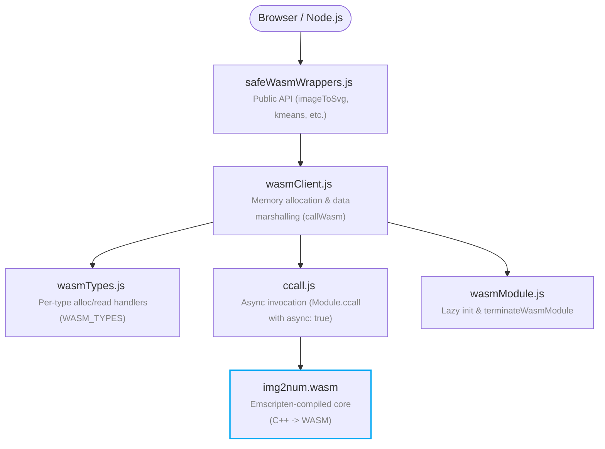

# JavaScript Binding Documentation

The JavaScript binding wraps Img2Num's WASM core in a clean, async API. It runs in browsers and Node.js. Every call runs on the thread that invokes it — the package does not use a Web Worker.

## Architecture



Key files:

| File                  | Purpose                                                                              |
| :-------------------- | :----------------------------------------------------------------------------------- |
| `safeWasmWrappers.js` | Public API — imageToSvg, bilateralFilter, blackThreshold, kmeans, findContours, etc. |
| `wasmClient.js`       | `callWasm` — memory allocation, data marshalling, and guaranteed cleanup             |
| `wasmTypes.js`        | `WASM_TYPES` — per-type `alloc`/`read` handlers for the WASM heap                     |
| `ccall.js`            | `ccallAsync` — invokes exports via `Module.ccall(..., { async: true })`              |
| `wasmModule.js`       | Lazy module initialization (`initWasmModule`) and teardown (`terminateWasmModule`)   |
| `index.js`            | Package exports                                                                      |

## WASM Memory Handling

:::important[Internally Managed]

This section covers a topic that is internally managed by Img2Num.

This is the interface between C++ and JavaScript.

:::

`callWasm` (in `wasmClient.js`) moves typed arrays between JavaScript and WASM
memory using the handlers defined in `WASM_TYPES` (`wasmTypes.js`):

1. **Allocation** — `_malloc` in WASM for the buffer size.
2. **Copy** — `HEAPU8.set()` / `HEAP32.set()` depending on array type.
3. **Call** — Invoke the exported WASM function with the pointers via `ccallAsync`, which calls `Module.ccall(funcName, retType, argTypes, args, { async: true })`.
4. **Read back** — `HEAPU8.slice()` / `HEAP32.slice()` (and `UTF8ToString` for strings) into detached JavaScript copies.
5. **Free** — `_free(ptr)` in a `finally` block so allocations are released even when a call throws.

## Module Lifecycle

- The WASM module is initialized on the first API call (lazy loading via `initWasmModule`); concurrent callers share a single in-flight initialization promise.
- A single module instance is cached and reused for all subsequent calls.
- `terminateWasmModule` optionally releases held resources (such as a WebGPU device) and resets the module to an uninitialized state; the next call re-initializes it.
- No external dependencies — pure JS + WASM.

## Error Handling

`callWasm` wraps failures and re-throws them with an `[Img2Num wasmClient]`
prefix, preserving the original error as `cause`:

```js
try {
  await imageToSvg({ pixels, width, height });
} catch (err) {
  console.error(err.message); // e.g. "[Img2Num wasmClient] Error: Unsupported type: ..."
  console.error(err.cause);   // the underlying error
}
```
